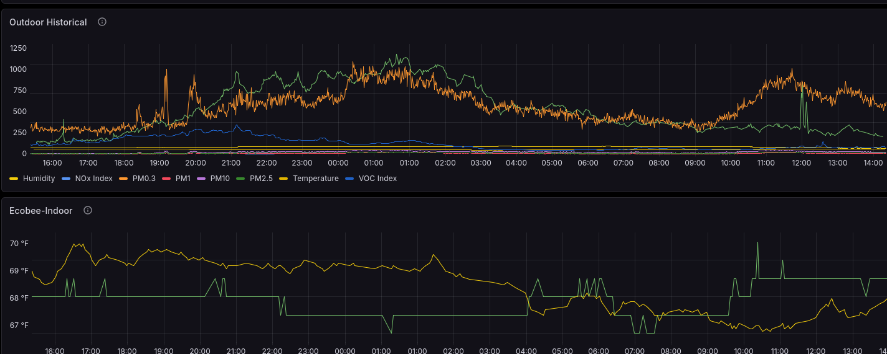
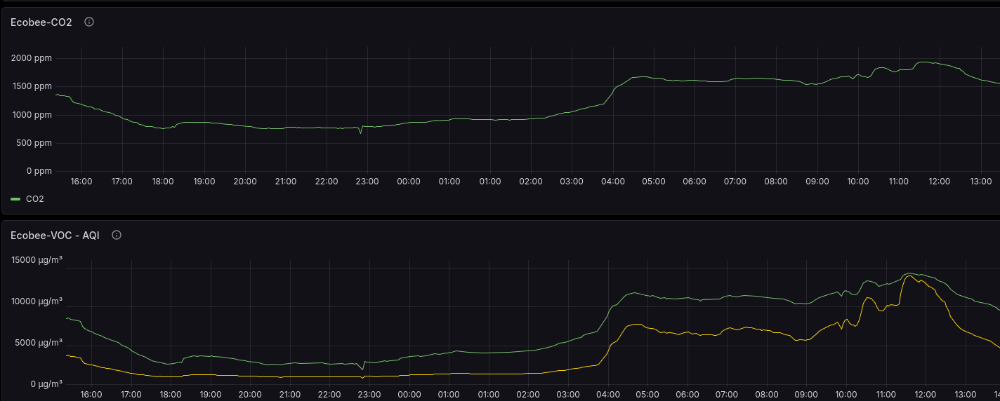

# Environmental Observability — Indoor/Outdoor Monitoring

**Independent technical project | 2026 | Public portfolio case study**

## Purpose and scope
Designed and validated a local-first environmental telemetry pipeline to observe indoor/outdoor conditions, establish baselines, compare historical trends, and investigate interventions. This is **not** medical monitoring, EEG, or a certified safety alarm.

## Architecture
Indoor/outdoor environmental sensors and thermostat → Home Assistant → InfluxDB → Grafana.

## Verified implementation
- Integrated environmental measurements and thermostat context into historical dashboards.
- Examined CO₂, temperature, humidity, particulate measurements, and source-specific VOC/AQI measurements without treating dissimilar sensors as interchangeable.
- Built Grafana time-series views and a categorical HVAC State timeline (idle, heating, fan, cooling).
- Used Flux queries to retrieve string-valued operating states from InfluxDB.
- Compared seven-day and thirty-day HVAC histories; observed historical heating and cooling in the longer window.
- Investigated baseline and ventilation-related changes, separating correlation from causation.
- Validated data across the source integration, time-series database, and dashboard rather than relying on the final visualization alone.

## Validation checkpoint
On November 1, 2026, verified thermostat temperature, humidity, CO₂, VOC and reported AQI trends; validated HVAC state visualizations and category mappings. A suggested PM0.3 display-unit refinement was **not** confirmed as completed.

## Troubleshooting method
Check sensor → Home Assistant entity → InfluxDB measurement/field → Flux query → Grafana panel units, time window and visualization. Record confirmed observations and limitations.

## Transferable skills
Sensor integration, time-series telemetry, data-quality checks, dashboard construction, state monitoring, fault isolation and technical documentation.

## Privacy and provenance
Sanitized from internal September–November 2026 Training Center records. No household identifiers, medical information, occupancy schedules, internal addresses, live endpoints or credentials. No private screenshots have been copied to this public repository pending image-level review.

## Visual verification — Grafana screenshots

The following screenshots were captured from the operating monitoring environment and retained as dated evidence. They demonstrate historical telemetry visualization, not clinical measurement or certified safety monitoring. The screenshots are illustrative snapshots rather than proof of continuous uptime.

### Outdoor environmental telemetry

*Figure 1. Outdoor historical sensor trends displayed in Grafana. Multiple measurements share the panel; units and scale must be interpreted separately by sensor field.*

### Indoor air-quality trends

*Figure 2. Ecobee CO₂ and reported VOC/AQI historical trends displayed in Grafana. Source-reported VOC/AQI readings should not be treated as interchangeable with AirGradient VOC Index or as clinical indicators.*

**Evidence limitations:** These images demonstrate functioning dashboards and stored measurements at the time captured. They do not independently establish sensor calibration, clinical validity, or alarm reliability.
